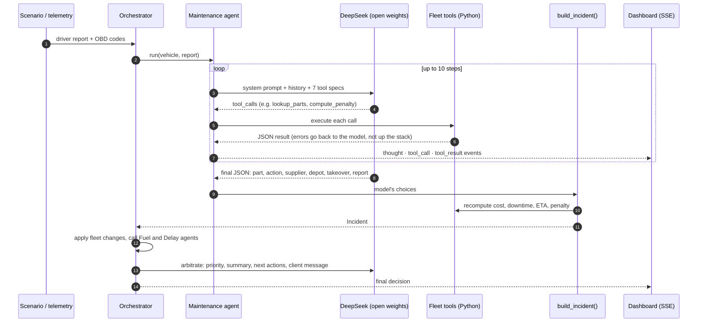
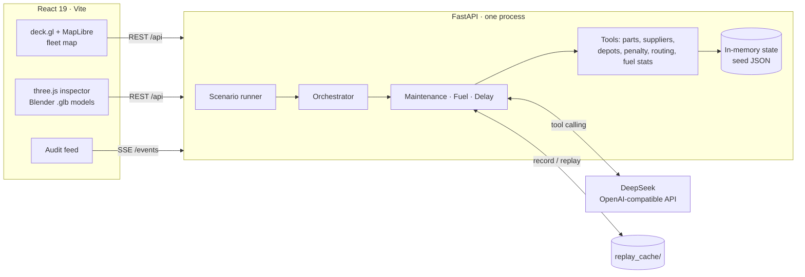

<p align="center">
  
</p>

<p align="center">
  
  
  
</p>
<p align="center">
  
  
  
  
  
  
  
  
</p>

<p align="center">
  <a href="#see-it-work">See it work</a> ·
  <a href="#how-it-works">How it works</a> ·
  <a href="#why-the-open-model-is-load-bearing">Why the model matters</a> ·
  <a href="#three-breakdowns-three-decisions">Results</a> ·
  <a href="#run-it">Run it</a> ·
  <a href="#whats-next">What's next</a>
</p>

---

Mid-afternoon on the A7 motorway. Truck **T-07** is carrying 10 pallets of medicine to Marrakech when the driver sends this to dispatch:

> *« Salam chef, lmoteur skhoun bzaf, l'aiguille wslat l7mer. Kayna ri7a dial liquide w chwiya d dokhan byed kaykhrej mn capot. W kayn wa7d sda3 bhal roulement l9eddam dial lmoteur. Nw9ef wla nkemmel? »*

That is Darija, typed in a hurry: the engine is very hot, the needle is in the red, there is a coolant smell and white smoke, and a bearing-like noise at the front of the engine. *Should I stop or keep going?*

A dispatcher now has about ten minutes to work out which part failed, whether to repair or replace it, which supplier can deliver in time, which depot has a workshop, whether a spare truck can arrive inside the 90-minute SLA, and, if not, who else can carry the load. Most fleets do this by phone, from memory.

**FleetSense** does it in under a minute. Four AI agents on an **open-weights DeepSeek model** read the message and the OBD codes, call the fleet's own tools, and come back with:

> **Stop now.** The water pump has failed (90% confidence; it is at 194% of its rated life). **Replace it**: AutoPièces Atlas, 2,450 MAD, delivered in 6.4 h. No spare truck reaches T-07 within the SLA, so **T-03**, 37 km away with 14 free pallets and the same destination, **takes the load**. **8,000 MAD penalty avoided.** T-07 goes to the Marrakech workshop, not Settat: Settat is closer but has no workshop.

Every figure in that answer was computed by code. The model chose, explained and wrote it.

**Who it is for:** dispatchers and fleet managers at Moroccan logistics companies and ambulance services, where SLA penalties are real money and drivers report problems in whatever language comes fastest.

---

## See it work

Every screenshot is the real dashboard, running against the backend with recorded DeepSeek runs.

<p align="center"></p>
<p align="center"><b>The ops room.</b> 16 trucks and ambulances live on a 3D map of Morocco, KPIs on top, the agents' audit feed on the right. Press <kbd>1</kbd> <kbd>2</kbd> <kbd>3</kbd> to trigger a breakdown.</p>

<table>
  <tr>
    <td width="50%"></td>
    <td width="50%"></td>
  </tr>
  <tr>
    <td><b>T-07 · water pump.</b> The failing part glows on a real diesel engine. Five pieces of evidence, the replace decision with its cost and downtime, and suppliers ranked on price, delay, punctuality, warranty and rating.</td>
    <td><b>A-03 · alternator.</b> An ambulance mid-transfer with the heart monitor on backup battery. The agent rules out the battery, replaces rather than repairs, and picks the only supplier fast enough.</td>
  </tr>
</table>

<p align="center"></p>
<p align="center"><b>T-12 · the fuel bill that was really a brake.</b> Exploded view plus the fuel drawer: +22.8% consumption over three fill-ups. The fuel agent finds 84% brake wear and a brake fault code, labels the cause <i>mechanical</i> and hands the case to Maintenance: a seized caliper is dragging the truck.</p>

---

## How it works

<p align="center"></p>

| Agent | What the model decides | What code computes | Where |
|---|---|---|---|
| **Orchestrator** | Final priority, a 3–4 line summary, next actions, the client message | Routing between agents, fleet side effects (vehicle out, replacement or takeover gets the mission) | `agents/orchestrator.py` |
| **Maintenance** | Which part failed and how sure it is, severity, repair or replace, which supplier, which depot, takeover or replacement | Part candidates from fault codes, supplier KPI scores, depot distances and ETAs, SLA penalties, spare load capacity | `agents/maintenance.py` |
| **Fuel** | The probable cause of each anomaly: mechanical, behaviour, fraud, detour | Overconsumption (+15% over 7 days), fills larger than the tank, fills with no km driven, excessive idling, route costs | `agents/fuel.py` |
| **Delay** | A better stop order when there are several, the message to the client | Start delay after the breakdown, every ETA and minute late | `agents/delay.py` |

The orchestrator also links the silos. A fuel anomaly with a mechanical cause goes straight to Maintenance, so a dragging brake shows up as one incident instead of a fuel ticket and a maintenance ticket nobody connects.

---

## Why the open model is load-bearing

Take the model out and FleetSense cannot run. The tools return numbers; nothing in the code can turn them into a decision.

- **It reads what drivers actually write.** Darija in Latin script with Arabizi numbers (`skhoun`, `l7mer`, `l9eddam`), French, or both in one message. The maintenance agent turns *"sda3 bhal roulement"* into "bearing noise at the front of the engine, a typical water-pump symptom".
- **It weighs trade-offs a rule table can't.** Repairing the A-03 alternator is cheaper (1,200 MAD) but takes 3 h, and the ambulance is moving a patient. The part is also at 268,000 km against a 200,000 km life. The agent replaces it.
- **It plans with tools.** In scenario 2 it calls 9 tools on its own: it finds no spare truck inside the SLA, computes the 8,000 MAD penalty, looks for a takeover, compares both penalties, and only then picks a supplier and a workshop depot.
- **It cannot invent a number.** `build_incident()` rebuilds the incident from the model's choices: costs, downtime, ETAs and penalties are recomputed from tools. A "repair" on a non-repairable part becomes "replace". A replacement vehicle that is not at the chosen depot is swapped for one that is.
- **Every step is on the record.** Each thought, tool call and result streams over SSE into the audit feed, so a manager can see why, not just what.

---

## Inside the agent loop



<details>
<summary><b>The 12 tools the agents can call</b></summary>

| Agent | Tool | Returns |
|---|---|---|
| Maintenance | `get_vehicle(vehicle_id)` | Telemetry, mileage, position, current mission |
| Maintenance | `lookup_parts(dtc, symptoms_text)` | Candidate parts from fault codes and symptoms |
| Maintenance | `get_part(part_id)` | Full catalog entry: repairable, life, costs, safety-critical |
| Maintenance | `score_suppliers(part_id, urgency, vehicle_type)` | Suppliers ranked on price, delivery, on-time rate, warranty, rating, weighted by urgency |
| Maintenance | `find_replacement(vehicle_id)` | Depots by road distance, with same-type spare vehicles and ETA |
| Maintenance | `compute_penalty(mission_id, replacement_eta_min)` | SLA penalty in MAD and whether the mission is at risk |
| Maintenance | `find_load_takeover(vehicle_id)` | Trucks on mission to the same destination with free pallets |
| Fuel | `get_fuel_stats(vehicle_id)` | Fill-ups, L/100 km against baseline, detected anomalies |
| Fuel | `get_vehicle(vehicle_id)` | Brake wear, fault codes, idle ratio |
| Fuel | `compare_routes(from, to, vehicle_id)` | Shortest, cheapest and fastest routes: fuel, tolls, driver time |
| Delay | `get_mission(mission_id)` | Stops, time windows, start delay after the breakdown |
| Delay | `simulate_order(stop_order)` | ETA and lateness per stop for a given order |

</details>

---

## Three breakdowns, three decisions

Seeded scenarios on a simulated Moroccan fleet (12 trucks, 4 ambulances, 6 depots, 15 parts, 6 suppliers). Decisions below are the recorded DeepSeek outputs in [`backend/replay_cache/`](backend/replay_cache/).

| | **1 · Ambulance A-03** | **2 · Truck T-07** | **3 · Truck T-12** |
|---|---|---|---|
| **Signal** | P0562 + P0620, battery 11.2 V, heart monitor on backup | P0217, coolant 118 °C, driver message in Darija | Fuel +22%, C0040, brake wear 84% |
| **Diagnosis** | Alternator · 90% | Water pump · 90% · *stop now* | Front-right brake caliper · 88% |
| **Decision** | Replace (268k km vs 200k life; repair = 3 h with a patient on board) | Replace (194% of rated life, safety-critical) | Replace (433k vs 300k km life, and faster than repair) |
| **Supplier** | Medi-Fleet Équipement · 2.6 h | AutoPièces Atlas · 2,450 MAD · 6.4 h | AutoPièces Atlas · 3,100 MAD · 5.2 h |
| **Fleet move** | Spare ambulance **A-04** from Settat, ETA 46 min | **T-03 takes the load** (no spare inside SLA) | Spare truck **T-10** at Rabat, ETA 80 min |
| **SLA** | 60 min · met | 90 min · would be missed | 90 min · met |
| **Penalty** | **0 MAD** | **8,000 MAD avoided** | **0 MAD** |
| **Tool calls** | 7 | 9 | 7 |

**Read these honestly.** The fleet, its telemetry, suppliers and penalties are simulated, and the three scenarios were written by us. They show that the agents reason correctly on cases we designed; they are not a benchmark. Tests in [`backend/tests/`](backend/tests/) pin the expected outcome of each scenario so a prompt change can't silently break one.

---

## Architecture



One FastAPI process holds the fleet in memory and streams every agent event over **Server-Sent Events**. Any OpenAI-compatible server works: change `DEEPSEEK_BASE_URL` and `DEEPSEEK_MODEL` to point FleetSense at a self-hosted DeepSeek on vLLM, so fleet data never leaves the company.

**Demo safety net.** Every live run records the raw model messages to `replay_cache/<scenario>-<agent>.json`. With `REPLAY=1` the agents replay those messages while the tools still run live, so the demo works offline and on stage Wi-Fi.

<details>
<summary><b>API endpoints</b></summary>

| Method | Path | What it does |
|---|---|---|
| `GET` | `/fleet` · `/depots` · `/missions` · `/parts` · `/suppliers` | Seed data and live fleet state |
| `GET` | `/scenarios` | The three breakdown scenarios |
| `POST` | `/scenario/{id}` | Start a scenario; the work streams on `/events` |
| `GET` | `/events` | SSE, one `AgentEvent` JSON per message |
| `GET` | `/incidents` · `/incidents/{id}` | Diagnosis, decision, suppliers, driver order, penalty, report |
| `GET` | `/vehicles/{id}/health` | Per-zone status that colours the 3D parts |
| `GET` | `/fuel/{vehicle_id}` · `/fuel/summary` | Fill-ups, L/100 km, anomalies with their causes |
| `POST` | `/route/compare` | Shortest, cheapest and fastest route options |
| `GET` | `/missions/{id}/path` · `/missions/{id}/eta` | Road path, progress, ETA per stop |
| `GET` | `/audit` | The full event log |
| `POST` | `/reset` | Reload the seed data |

Contract: [`shared/contracts.md`](shared/contracts.md). Models: [`backend/app/schemas.py`](backend/app/schemas.py), mirrored in [`shared/types.ts`](shared/types.ts).
</details>

---

## Run it

**Backend** (Python 3.11+):

```bash
cd backend
python -m venv .venv
.venv/Scripts/activate              # macOS/Linux: source .venv/bin/activate
pip install -r requirements.txt
cp ../.env.example ../.env          # add DEEPSEEK_API_KEY
uvicorn app.main:app --reload --port 8000
```

**Frontend** (Node 20+), in a second terminal:

```bash
cd frontend
npm ci
npm run dev
```

Open <http://localhost:5173>, wait for the intro, then press <kbd>1</kbd>, <kbd>2</kbd> or <kbd>3</kbd>. Click a vehicle to open the 3D inspector: <kbd>E</kbd> explodes it, <kbd>F</kbd> opens the fuel drawer, <kbd>←</kbd> <kbd>→</kbd> switch vehicles.

<details>
<summary><b>No API key?</b></summary>

| Mode | Command | What runs |
|---|---|---|
| Replay | `REPLAY=1 uvicorn app.main:app --port 8000` | Recorded DeepSeek messages, live tools |
| Mock | `MOCK=1 uvicorn app.main:app --port 8000` | A scripted event stream, no model at all (for UI work) |

PowerShell: `$env:REPLAY="1"; uvicorn app.main:app --port 8000`.
</details>

<details>
<summary><b>Tests</b></summary>

```bash
cd backend
python -m pytest -q        # 21 tests: tools, the three scenarios end to end on replays, fuel and delay
```
</details>

<details>
<summary><b>Configuration</b> (<code>.env</code>)</summary>

| Variable | Default | What it does |
|---|---|---|
| `DEEPSEEK_API_KEY` | (empty) | API key |
| `DEEPSEEK_BASE_URL` | `https://api.deepseek.com` | Any OpenAI-compatible endpoint, including your own vLLM |
| `DEEPSEEK_MODEL` | `deepseek-chat` | Model name |
| `REPLAY` | `0` | `1` = replay recorded model messages |
| `MOCK` | `0` | `1` = scripted events, no model |
</details>

<details>
<summary><b>Repository layout</b></summary>

```
backend/
  app/
    agents/        orchestrator, maintenance, fuel, delay
    tools/         parts, suppliers, depots, penalty, routing, fuel stats, health, geo
    llm.py         DeepSeek tool-calling loop + record/replay
    simulator.py   scenario runner (live or mock)
    main.py        FastAPI + SSE; routes_fuel.py for fuel, routes, ETAs
  data/            vehicles, missions, depots, parts, suppliers, fuel logs, road graph, scenarios
  replay_cache/    recorded model runs for offline demos
  tests/
frontend/          React 19 + Vite + TypeScript: map, audit feed, 3D inspector, fuel drawer
assets/
  blender/         scripts that build the truck and ambulance with clickable per-part nodes
  models/          .glb models used by the inspector
shared/            API contract, TypeScript types, team briefs
```
</details>

---

## The stack

| Layer | Tech |
|---|---|
| **AI** | DeepSeek (open weights) through the `openai` SDK, native tool calling, JSON outputs |
| **Backend** | Python · FastAPI · Pydantic v2 · sse-starlette · NetworkX (road graph, toll vs. national roads) |
| **Frontend** | React 19 · TypeScript · Vite · Tailwind 4 · Zustand · Framer Motion · Recharts |
| **Map** | MapLibre GL · deck.gl (paths, 3D vehicle meshes, depots) |
| **3D** | three.js · React Three Fiber · drei · Blender-built `.glb` trucks and ambulances, one clickable node per part |
| **Quality** | pytest · oxlint |

---

## What's next

- **Self-hosted DeepSeek.** Same client, pointed at vLLM inside the fleet operator's network.
- **Voice notes.** Drivers send WhatsApp voice messages in Darija; transcribe with an open speech model and feed the same agents.
- **Real telematics.** Plug OBD-II dongles and fuel-card feeds in place of the simulator.
- **Learn from outcomes.** Log what the mechanic actually found and feed it back, so the agent learns this fleet's failure patterns.
- **Driver app.** Push the driver order and depot route straight to the driver's phone, with one-tap confirmation.
- **Fresh evaluation.** A larger set of unseen breakdown scenarios to measure diagnosis accuracy instead of demonstrating it.

---

## The crew

Three lanes, one binding API contract ([`shared/contracts.md`](shared/contracts.md)). Each of us owned our own files and merged through small PRs.

<!-- TODO: add names -->
| Lane | Built |
|---|---|
| **A · Agents core** | DeepSeek tool loop with record/replay, maintenance agent, orchestrator, fleet tools, seed data, Blender vehicles |
| **B · Fuel & delay** | Fuel agent, delay agent, routing on the road graph, fuel statistics, REST routes |
| **C · Frontend** | Ops-room dashboard, deck.gl map, audit feed, 3D inspector, fuel drawer |

---

<sub>**Credits.** The diesel engine inside both vehicles is ["Truck Engine"](https://sketchfab.com/3d-models/truck-engine-d7ff313ff1e64c4db803e39b600a0fbf) by **andreviewport**, licensed CC BY 4.0. Map data © OpenStreetMap contributors, © CARTO.</sub>

<sub>**Data note.** The fleet, telemetry, missions, suppliers, prices and penalties are simulated. Supplier names, drivers and companies in the seed data are fictional. Built for the UM6P Hackathon, open-models track.</sub>
