<p align="center">
  
</p>

<p align="center">
  
  
  
</p>
<p align="center">
  
  
  
  
  
  
  
  
</p>

<p align="center">
  <a href="#1--the-problem">Problem</a> ·
  <a href="#2--who-uses-it-and-why-it-pays">Usefulness</a> ·
  <a href="#3--ai--approach">AI + approach</a> ·
  <a href="#4--implementation">Implementation</a> ·
  <a href="#5--whats-original">Originality</a> ·
  <a href="#run-it">Run it</a> ·
  <a href="#the-team">Team</a>
</p>

---

### In one minute

A truck breaks down on the motorway. The driver sends a panicked message in Darija. **FleetSense** reads it together with the vehicle's fault codes, and four AI agents on the **open-weights DeepSeek-V3 model** work through the fleet's own tools: which part failed, repair or replace, which supplier, which depot, can a spare vehicle arrive inside the contract SLA, and if not, which other truck can take the load. In under a minute the fleet manager gets a decision with its evidence, its cost in MAD and a message ready for the client. **Every number comes from code; the model reasons, chooses and explains.**

| Judging criterion | Where to look |
|---|---|
| **Problem** · clear and meaningful | [1 · The problem](#1--the-problem) |
| **Usefulness** · practical value | [2 · Who uses it](#2--who-uses-it-and-why-it-pays) · [three real decisions](#three-breakdowns-three-decisions) |
| **AI + approach** · meaningful and appropriate | [3 · AI + approach](#3--ai--approach): the open model, what we diagnose from, KPIs, tools, guardrails |
| **Implementation** · working and verifiable | [4 · Implementation](#4--implementation): screenshots, recorded runs, 29 tests, [run it in one command](#run-it) |
| **Originality** · growth potential | [5 · What's original](#5--whats-original) · [roadmap](#whats-next) |

---

## 1 · The problem

Mid-afternoon on the A7 motorway. Truck **T-07** is carrying 10 pallets of medicine to Marrakech when the driver sends this to dispatch:

> *« Salam chef, lmoteur skhoun bzaf, l'aiguille wslat l7mer. Kayna ri7a dial liquide w chwiya d dokhan byed kaykhrej mn capot. W kayn wa7d sda3 bhal roulement l9eddam dial lmoteur. Nw9ef wla nkemmel? »*

The engine is very hot, the needle is in the red, there is a coolant smell and white smoke, and a bearing-like noise at the front of the engine. *Should I stop or keep going?*

The dispatcher now has minutes to answer six questions at once, from six different places:

| Question | Where the answer lives today |
|---|---|
| Which part failed? | The driver's words + a fault code on the dashboard |
| Repair or replace? | The mechanic's experience, the part's mileage |
| Which supplier, how fast? | Phone calls, a price list in Excel |
| Which depot has a workshop and a spare truck? | Memory, more phone calls |
| What does the delay cost us? | The client contract: SLA minutes, MAD per hour, flat penalty |
| Can another truck take the load? | Nobody checks |

Breakdowns, fuel overspend and late deliveries are handled as **three separate problems by three separate people**. A dragging brake shows up as a fuel bill in one office and a late delivery in another, and nobody links them. For an **ambulance**, the same delay is not a penalty, it is a patient on a backup battery.

---

## 2 · Who uses it, and why it pays

**Users:** the dispatcher on shift, who needs one clear order to give the driver, and the fleet manager, who needs the cost, the SLA risk and the audit trail.

### An example customer

Picture a Moroccan national carrier in the mould of **CTM Messagerie** or a regional 3PL: a few hundred trucks on the Casablanca–Marrakech–Agadir–Fès corridors, contracts with pharmaceutical and retail clients that carry SLA penalties, and drivers who report problems by WhatsApp in Darija. Or an **ambulance operator** running inter-hospital transfers for clinics, where a missed replacement window is a clinical risk, not just a fee.

*(These are illustrative profiles of the companies FleetSense is built for, not customers or partners.)*

What a rollout looks like for them:

1. **Plug in.** A standard telematics box in each vehicle's OBD-II / CAN port (most fleets already have GPS trackers that can read it).
2. **Load their data.** Vehicles, depots and spare vehicles, the parts catalog, supplier price lists with delivery times, and each client contract's SLA and penalties. All plain JSON today, an ERP/TMS connector tomorrow.
3. **Keep the dispatcher in charge.** FleetSense proposes; the dispatcher approves the order to the driver and the purchase.

### What changes

| | Today | With FleetSense |
|---|---|---|
| Time to a decision | Tens of minutes of phone calls | **Under a minute**, with evidence |
| Repair vs. replace | Gut feeling | Mileage vs. rated life, safety, downtime, cost, all shown |
| Supplier choice | Whoever answers first | Ranked on 5 KPIs, weighted by urgency |
| SLA penalty | Discovered on the invoice | **Computed before the decision**, in MAD |
| Load takeover | Rarely considered | Checked automatically: in scenario 2 it saves **8,000 MAD** |
| Fuel, maintenance, delays | Three silos | One incident, one timeline |

---

## 3 · AI + approach

<p align="center">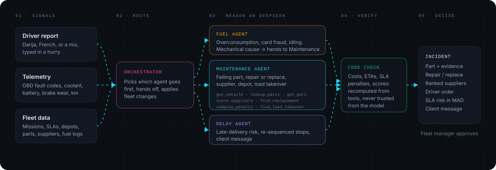</p>

### The open model: DeepSeek-V3

| | |
|---|---|
| **Model** | DeepSeek-V3 series, served as `deepseek-chat` through DeepSeek's OpenAI-compatible API |
| **Why open weights** | The same weights are published on Hugging Face, so a fleet operator can **self-host** it (vLLM, SGLang) and keep vehicle positions, client contracts and driver messages inside the company. Switching is two environment variables: `DEEPSEEK_BASE_URL` and `DEEPSEEK_MODEL`. |
| **Why this model** | Strong native **tool calling**, reliable **JSON output**, good French, and it copes with Darija written in Latin script with Arabizi digits (`skhoun`, `l7mer`, `l9eddam`) |
| **How we call it** | `temperature 0.2`, up to 10 tool-calling steps per agent, the final answer must be one JSON object (we re-ask if it isn't) |
| **Where it runs** | Every agent goes through one loop, [`backend/app/llm.py`](backend/app/llm.py), which also **records** each run for offline replay |

**Why the model is load-bearing.** Take it out and FleetSense cannot decide anything. The tools return facts; turning them into *"stop now, replace the pump, send T-03"* takes reasoning no rule table covers:

- **Reading drivers.** *"sda3 bhal roulement l9eddam"* becomes "bearing noise at the front of the engine, a typical water-pump symptom", and that becomes a search term for `lookup_parts`.
- **Weighing trade-offs.** Repairing the A-03 alternator costs 1,200 MAD but takes 3 h with a patient on board, and the part is at 268,000 km against a 200,000 km life. The agent replaces it.
- **Planning.** In scenario 2 the agent makes 9 tool calls on its own: no spare truck inside the SLA, so it prices the penalty, looks for a takeover, compares both, then picks a supplier and a depot **with a workshop** (Marrakech, not the closer Settat).
- **Linking silos.** The fuel agent sees +21% consumption on T-12, reads 84% brake wear and a brake code, labels the cause *mechanical*, and the orchestrator hands it to Maintenance.

### What we diagnose from, and what we diagnose on

<p align="center">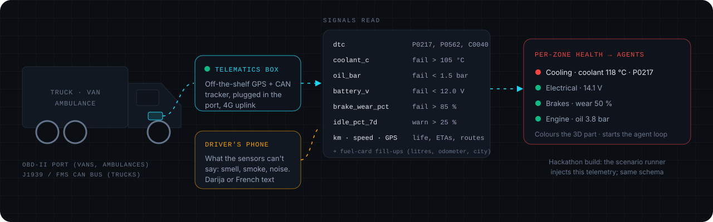</p>

**The physical object: a telematics box.** Every vehicle carries an off-the-shelf GPS/CAN tracker plugged into its diagnostic port: **OBD-II** on vans and ambulances, **J1939 / FMS** on heavy trucks. It streams standard **fault codes** (P0217 engine overheat, P0562 low system voltage, C0040 brake circuit…) and live readings over 4G. The driver's phone adds what no sensor reports: the smell, the smoke, the noise. In this hackathon build, the scenario runner injects that telemetry with exactly the same schema ([`Telemetry`](backend/app/schemas.py)).

**The digital object: a 3D twin of each vehicle.** The truck and the ambulance are built in **Blender** ([`assets/blender/`](assets/blender/)) with a real inline-6 diesel inside. **Every part is its own clickable node** carrying its catalog `part_id` and `zone` (`P-WPUMP` water pump, `P-ALT` alternator, `P-BCAL` brake caliper…). When the agent names a part, that exact part glows red on the engine, and clicking it opens the agent's evidence.

| Zone | Rule that flags it (code) | Then the agent… |
|---|---|---|
| Cooling | coolant > 105 °C fail, > 98 °C warn | weighs the driver's words and part mileage to name the part |
| Electrical | battery < 12.0 V fail, < 13.2 V warn | rules alternator vs. battery in or out |
| Engine | oil < 1.5 bar fail, < 2.5 bar warn | decides severity: monitor, drive to depot, stop now |
| Brakes | wear > 85 % fail, > 70 % warn | links it to fuel overconsumption if there is one |
| Fuel | idle > 25 % over 7 days | classifies: behaviour, fraud, mechanical, detour |
| Any | a fault code that matches a catalog part | uses it as evidence, never alone |

### How the agents get the KPIs and work with them

The model never invents a figure. It **asks a tool**, reads the KPI, and decides. Here is every KPI it works with and where it comes from.

**Supplier ranking** · [`tools/suppliers.py`](backend/app/tools/suppliers.py). Each offer is scored 0–100 on five KPIs, min-max normalised across the suppliers that stock the part. **The weights shift with urgency**, which the agent sets (critical for an ambulance, urgent for a truck on mission):

<p align="center"></p>

That is why the ambulance gets **Medi-Fleet** (2.6 h delivery, score 87) while a cheaper supplier at 6.3 h loses: at *critical* urgency, delivery time is half the score. The agent then explains the pick in words the manager can check against the score breakdown shown in the UI.

**SLA penalty** · [`tools/penalty.py`](backend/app/tools/penalty.py). From the client contract on each mission:

```
replacement ETA ≤ SLA          → 0 MAD
replacement ETA > SLA          → (minutes late ÷ 60) × MAD per hour
no replacement vehicle at all  → flat contract penalty
```

<p align="center"></p>

T-07: the nearest spare truck arrives in 137 min against a 90-min SLA, so 1,175 MAD late, or the 8,000 MAD flat fee if nothing comes. A takeover by T-03 makes it **0**.

**Repair vs. replace** · [`tools/parts.py`](backend/app/tools/parts.py) and `get_part`. For each candidate part: repair cost and hours, replacement labour hours, typical life in km, whether it is repairable and safety-critical. The agent compares, then `build_incident()` computes the cost (supplier price + labour × 350 MAD/h) and the downtime.

**Fleet logistics** · [`tools/depots.py`](backend/app/tools/depots.py). Road distance and ETA to each depot, whether it has a workshop, which spare vehicles of the same type are available, and which trucks on the road share a destination and have enough free pallets.

**Fuel** · [`tools/fuel_stats.py`](backend/app/tools/fuel_stats.py). L/100 km over 7 days against the vehicle's baseline (anomaly above +15%), fills larger than the tank, fills with under 20 km driven, idling above 25%. Routes are priced as fuel + tolls (×truck multiplier) + driver time on the road graph.

**Fleet KPIs on the dashboard.** Vehicles on mission, plans waiting for approval, penalties avoided (MAD), and fuel spend, overspend and alerts over the last 7 days, computed from the fill-up logs.

### The tools

<details open>
<summary><b>12 tools, 3 agents (the orchestrator arbitrates without tools)</b></summary>

| Agent | Tool | Returns |
|---|---|---|
| Maintenance | `get_vehicle(vehicle_id)` | Telemetry, mileage, position, current mission |
| Maintenance | `lookup_parts(dtc, symptoms_text)` | Candidate parts from fault codes (×3) and driver symptoms (×1) |
| Maintenance | `get_part(part_id)` | Repairable, rated life, repair/replace cost and hours, safety-critical |
| Maintenance | `score_suppliers(part_id, urgency, vehicle_type)` | Suppliers ranked on the 5 KPIs above, with the score breakdown |
| Maintenance | `find_replacement(vehicle_id)` | Depots by road distance, ETA, workshop, same-type spare vehicles |
| Maintenance | `compute_penalty(mission_id, replacement_eta_min)` | SLA penalty in MAD and whether the mission is at risk |
| Maintenance | `find_load_takeover(vehicle_id)` | Trucks on mission to the same destination with enough free pallets |
| Fuel | `get_fuel_stats(vehicle_id)` | Fill-ups, L/100 km vs. baseline, detected anomalies |
| Fuel | `get_vehicle(vehicle_id)` | Brake wear, fault codes, idle ratio |
| Fuel | `compare_routes(from, to, vehicle_id)` | Shortest, cheapest and fastest routes: fuel, tolls, driver time |
| Delay | `get_mission(mission_id)` | Stops, time windows, start delay after the breakdown |
| Delay | `simulate_order(stop_order)` | ETA and minutes late per stop for a given order |

Tools never crash the agent: an error goes back to the model as `{"error": ...}` so it can correct itself.
</details>

| Agent | What the model decides | What code computes |
|---|---|---|
| **Orchestrator** | Priority, a 3–4 line summary, next actions, the client message | Routing between agents, fleet changes (vehicle out, replacement or takeover gets the mission) |
| **Maintenance** | Failing part and confidence, severity, repair or replace, supplier, depot, takeover | Part candidates, supplier scores, ETAs, penalties, spare capacity |
| **Fuel** | Probable cause of each anomaly | Every anomaly and every route cost |
| **Delay** | A better stop order, the client message | Start delay, every ETA and minute late |

### Guardrails: the model reasons, code does the maths

- **Numbers are recomputed.** `build_incident()` rebuilds the incident from the model's *choices*: cost, downtime, ETA and penalty all come from tools again.
- **Impossible choices are corrected.** "Repair" on a non-repairable part becomes "replace". A replacement vehicle that isn't at the chosen depot is swapped for one that is.
- **People decide.** The output is a proposal with evidence; nothing counts until the manager clicks *Approuver le plan*, and that goes on the record too.
- **Everything is on the record.** Each thought, tool call and result streams over SSE into the audit feed.

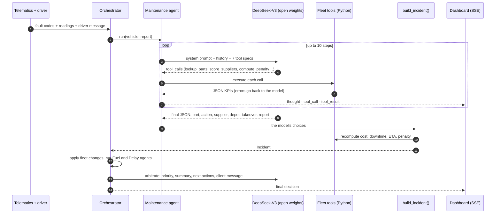

---

## 4 · Implementation

It runs end to end: Python agents, a live dashboard, and real recorded DeepSeek runs you can replay offline.

<p align="center">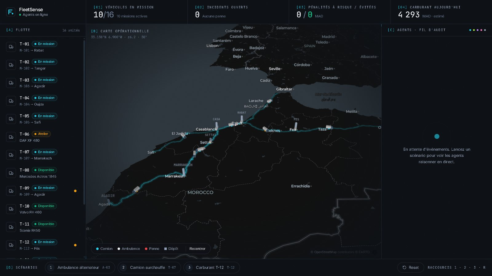</p>
<p align="center"><b>The ops room.</b> 16 trucks and ambulances on a 3D map of Morocco, live KPIs on top, and a decision card for each breakdown with one button to approve the plan. The full audit log opens on demand. Press <kbd>1</kbd> <kbd>2</kbd> <kbd>3</kbd> to trigger a breakdown.</p>

<table>
  <tr>
    <td width="50%">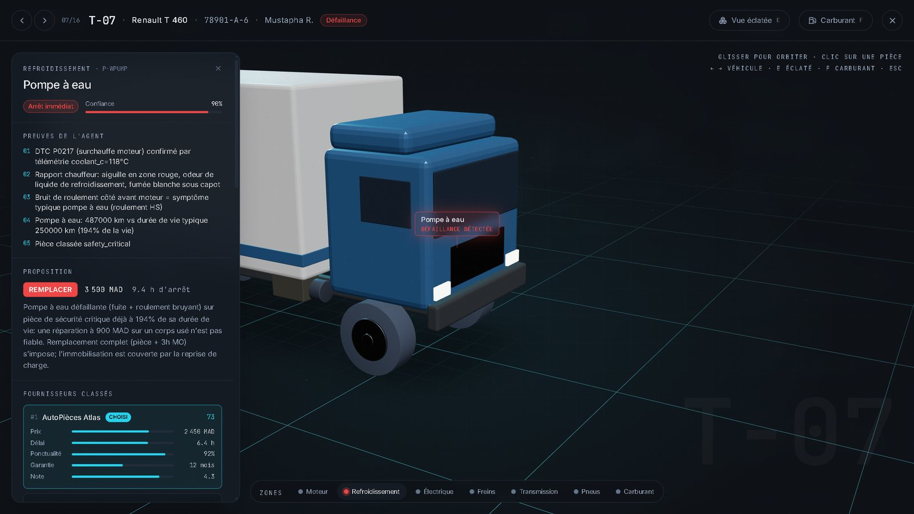</td>
    <td width="50%">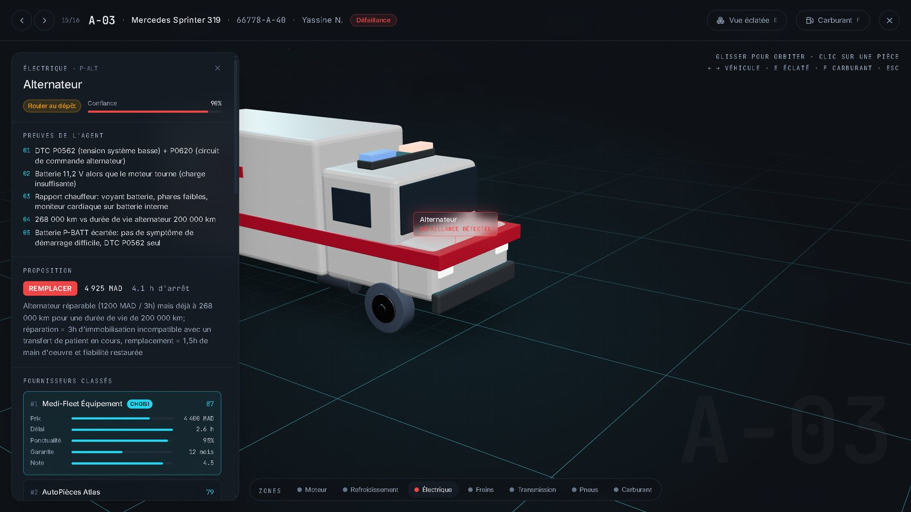</td>
  </tr>
  <tr>
    <td><b>T-07 · water pump.</b> The failing part glows on the real diesel engine. Five pieces of evidence, the replace decision with cost and downtime, and suppliers ranked on the five KPIs.</td>
    <td><b>A-03 · alternator.</b> An ambulance mid-transfer with the heart monitor on backup battery. The agent rules out the battery, replaces rather than repairs, and picks the only supplier fast enough.</td>
  </tr>
</table>

<p align="center">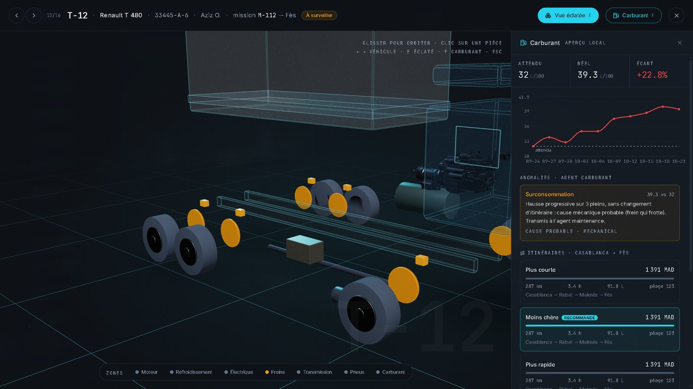</p>
<p align="center"><b>T-12 · the fuel bill that was really a brake.</b> Exploded view plus the fuel drawer: +20.9% consumption. The fuel agent finds 84% brake wear and a brake fault code, labels the cause <i>mechanical</i> and hands the case to Maintenance.</p>

### Three breakdowns, three decisions

Seeded scenarios on a simulated Moroccan fleet: 12 trucks, 4 ambulances, 6 depots, 15 parts, 6 suppliers. Every decision below is a recorded DeepSeek output in [`backend/replay_cache/`](backend/replay_cache/).

| | **1 · Ambulance A-03** | **2 · Truck T-07** | **3 · Truck T-12** |
|---|---|---|---|
| **Signal** | P0562 + P0620, battery 11.2 V, heart monitor on backup | P0217, coolant 118 °C, driver message in Darija | Fuel +21%, C0040, brake wear 84% |
| **Diagnosis** | Alternator · 90% | Water pump · 90% · *stop now* | Front-right brake caliper · 88% |
| **Decision** | Replace (268k km vs 200k life; repair = 3 h with a patient on board) | Replace (194% of rated life, safety-critical) | Replace (433k vs 300k km life, and faster than repair) |
| **Supplier** | Medi-Fleet Équipement · 4,400 MAD · 2.6 h | AutoPièces Atlas · 2,450 MAD · 6.4 h | AutoPièces Atlas · 3,100 MAD · 5.2 h |
| **Fleet move** | Spare ambulance **A-04** from Settat, ETA 46 min | **T-03 takes the load** (no spare inside SLA) | Spare truck **T-10** at Rabat, ETA 80 min |
| **SLA** | 60 min · met | 90 min · would be missed | 90 min · met |
| **Penalty** | **0 MAD** | **8,000 MAD avoided** | **0 MAD** |
| **Tool calls** | 6 | 9 | 8 |

**Read these honestly.** The fleet, telemetry, suppliers and penalties are simulated, and we wrote the three scenarios. They show the agents reason correctly on cases we designed; they are not a benchmark. The tests in [`backend/tests/`](backend/tests/) pin each scenario's expected outcome so a prompt change can't silently break one.

### Architecture

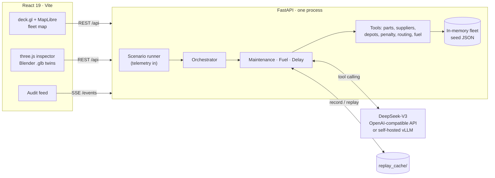

One FastAPI process holds the fleet in memory and streams every agent event over **Server-Sent Events**. **Demo safety net:** every live run records the raw model messages to `replay_cache/`; with `REPLAY=1` the agents replay them while the tools still run live, so the demo works offline.

<details>
<summary><b>API endpoints</b></summary>

| Method | Path | What it does |
|---|---|---|
| `GET` | `/fleet` · `/depots` · `/missions` · `/parts` · `/suppliers` | Seed data and live fleet state |
| `GET` | `/scenarios` | The three breakdown scenarios |
| `POST` | `/scenario/{id}` | Start a scenario; the work streams on `/events` |
| `GET` | `/events` | SSE, one `AgentEvent` JSON per message |
| `GET` | `/incidents` · `/incidents/{id}` | Diagnosis, decision, suppliers, driver order, penalty, report |
| `GET` | `/vehicles/{id}/health` | Per-zone status that colours the 3D parts |
| `GET` | `/fuel/{vehicle_id}` · `/fuel/summary` | Fill-ups, L/100 km, anomalies with their causes |
| `POST` | `/route/compare` | Shortest, cheapest and fastest route options |
| `GET` | `/missions/{id}/path` · `/missions/{id}/eta` | Road path, progress, ETA per stop |
| `GET` | `/audit` | The full event log |
| `POST` | `/incidents/{id}/approve` | The manager signs off the plan; goes on the audit trail |
| `POST` | `/reset` | Reload the seed data |

Contract: [`shared/contracts.md`](shared/contracts.md). Models: [`backend/app/schemas.py`](backend/app/schemas.py), mirrored in [`shared/types.ts`](shared/types.ts).
</details>

<details>
<summary><b>The stack</b></summary>

| Layer | Tech |
|---|---|
| **AI** | DeepSeek-V3 (open weights) via the `openai` SDK, native tool calling, JSON outputs, record/replay |
| **Backend** | Python · FastAPI · Pydantic v2 · sse-starlette · NetworkX (road graph with toll and national roads) |
| **Frontend** | React 19 · TypeScript · Vite · Tailwind 4 · Zustand · Framer Motion · Recharts |
| **Map** | MapLibre GL · deck.gl (paths, 3D vehicle meshes, depots) |
| **3D** | three.js · React Three Fiber · drei · Blender-built `.glb` twins, one clickable node per part |
| **Quality** | pytest (29 tests) · oxlint |
</details>

<details>
<summary><b>Repository layout</b></summary>

```
backend/
  app/
    agents/        orchestrator, maintenance, fuel, delay
    tools/         parts, suppliers, depots, penalty, routing, fuel stats, health, geo
    llm.py         DeepSeek tool-calling loop + record/replay
    simulator.py   scenario runner (live or mock)
    main.py        FastAPI + SSE; routes_fuel.py for fuel, routes, ETAs
  data/            vehicles, missions, depots, parts, suppliers, fuel logs, road graph, scenarios
  replay_cache/    recorded model runs for offline demos
  tests/
frontend/          React 19 + Vite + TypeScript: map, audit feed, 3D inspector, fuel drawer
assets/
  blender/         scripts that build the truck and ambulance with per-part nodes
  models/          .glb models used by the inspector
shared/            API contract, TypeScript types, team briefs
```
</details>

---

## 5 · What's original

- **Darija in, decision out.** Drivers write the way they talk. The agent turns Moroccan Arabizi into a part search and a diagnosis, with no translation step.
- **One root cause across three silos.** Fuel, maintenance and delays are usually three tools. Here a fuel anomaly with a mechanical cause becomes a maintenance incident, and the delay agent re-plans the mission it affects.
- **The load takeover.** Instead of only "send a spare truck", the agent looks for a truck already on the road with free pallets to the same city, and prices both options in MAD.
- **The model can't lie about money.** It chooses; code recomputes every cost, ETA and penalty before anyone sees them.
- **Diagnosis you can see.** The failing part glows on a 3D twin of the vehicle, built in Blender with one node per part.

### What's next

<p align="center"></p>

The pilot needs no new AI: the same client points at a self-hosted DeepSeek with two environment variables, and real telematics boxes send the same `Telemetry` schema the scenario runner uses today.

---

## Run it

```bash
python run.py
```

That's all (Python 3.11+, plus Node 20+ for the first build). It installs what's missing, builds the frontend, serves everything on one port and opens <http://127.0.0.1:8000>. On Windows you can double-click `FleetSense.bat`. No API key needed: this is the offline demo, recorded DeepSeek runs driving the live tools. The map tiles and fonts still come from the internet.

Press <kbd>1</kbd>, <kbd>2</kbd> or <kbd>3</kbd> to trigger a breakdown, <kbd>R</kbd> to reset. Click a vehicle to open the 3D inspector: <kbd>E</kbd> explodes it, <kbd>F</kbd> opens the fuel drawer, <kbd>←</kbd> <kbd>→</kbd> switch vehicles.

| Command | What runs |
|---|---|
| `python run.py` | Offline demo: recorded model messages, live tools, no cost |
| `python run.py --live` | The real model, about 30 s per scenario (copy `.env.example` to `.env` and add `DEEPSEEK_API_KEY`) |
| `python run.py --build` | Rebuild the frontend first (it also rebuilds by itself when sources change) |

<details>
<summary><b>Working on the code</b></summary>

```bash
python -m uvicorn --app-dir backend app.main:app --reload --port 8000   # REPLAY=1 for the recorded runs, MOCK=1 for scripted events
npm --prefix frontend run dev                                           # http://127.0.0.1:5173
```

Use `127.0.0.1`, not `localhost`: on Windows `localhost` tries IPv6 first and loses 200 ms on every connection.
</details>

<details>
<summary><b>Tests and configuration</b></summary>

```bash
cd backend
python -m pytest -q        # 29 tests: tools, the three scenarios end to end on the recorded runs, fuel and delay
```

| Variable | Default | What it does |
|---|---|---|
| `DEEPSEEK_API_KEY` | (empty) | API key |
| `DEEPSEEK_BASE_URL` | `https://api.deepseek.com` | Any OpenAI-compatible endpoint, including your own vLLM |
| `DEEPSEEK_MODEL` | `deepseek-chat` | Model name |
| `REPLAY` | `0` | `1` = replay recorded model messages (`run.py` sets it) |
| `REPLAY_STEP_SEC` | `0` | Pause between replayed model steps; `run.py` uses `1.1` so the feed builds up like a live run |
| `MOCK` | `0` | `1` = scripted events, no model |
</details>

---

## The team

Three lanes, one binding API contract ([`shared/contracts.md`](shared/contracts.md)). Each of us owned our own files and merged through small PRs, all within the hackathon day.

<p align="center"></p>

---

<sub>**Credits.** The diesel engine inside both vehicles is ["Truck Engine"](https://sketchfab.com/3d-models/truck-engine-d7ff313ff1e64c4db803e39b600a0fbf) by **andreviewport**, licensed CC BY 4.0. Map data © OpenStreetMap contributors, © CARTO.</sub>

<sub>**Data note.** The fleet, telemetry, missions, suppliers, prices and penalties are simulated. Supplier names, drivers and client companies in the seed data are fictional; companies named in section 2 are illustrative examples, not partners. Built for the UM6P Hackathon, open-models track.</sub>
